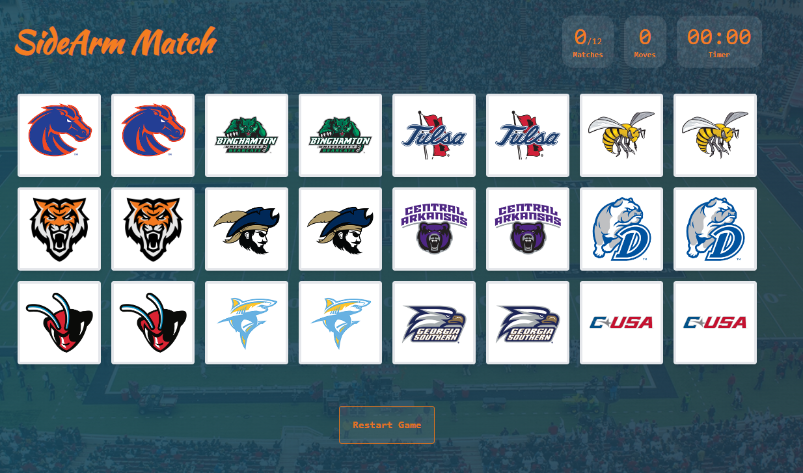

<h1 align="center">
  
</h1>

<p align="center">
  <a href="#-tecnologies">Tecnologies</a>&nbsp;&nbsp;&nbsp;|&nbsp;&nbsp;&nbsp;
  <a href="#-project">Project</a>&nbsp;&nbsp;&nbsp;|&nbsp;&nbsp;&nbsp;
  <a href="#-deploy">Deploy</a>&nbsp;&nbsp;&nbsp;|&nbsp;&nbsp;&nbsp;
  <a href="#-license">License</a>&nbsp;&nbsp;&nbsp;|&nbsp;&nbsp;&nbsp;
  <a href="#-run">Run the App</a>
</p>

<p align="center">
 

  
</p>

<br>

<p align="center">
  
</p>

## 💻 Project

This project `SideArm Match` is a memory game application, where it is measure the player moves and time to finish all pair matches cards. It was chosen the Vue3 framework in its new version to apply the composition API.

## 🚀 Tecnologies

This project was developed with:

- Vue 3 + Vite
- Tailwind CSS
- Dependencies PartyJs and Lottiefiles


## 📝 License

This project is MIT License.

## 🎫 Deploy

The game runs on [Hostinger](https://www.hostinger.com/) as a Node.js web app. It is deployed from this repo, and every push to `main` redeploys it. A single Node server serves the game and runs every game, single player included. See [server/README.md](server/README.md) for the settings.

## 🏍️ Run the Project

```shell
# install dependencies
npm install

# run both, in two terminals (single player is played on the server too)
npm run server   # game server on :3001
npm run dev      # game on :5173 (Vite forwards multiplayer traffic to :3001)

# run it like production: one server for the page and multiplayer
npm run build && npm start   # http://localhost:3001

# game rule tests
npm test
```

For multiplayer, open the game in two browser windows. Each tab counts as a separate player.

❤️
